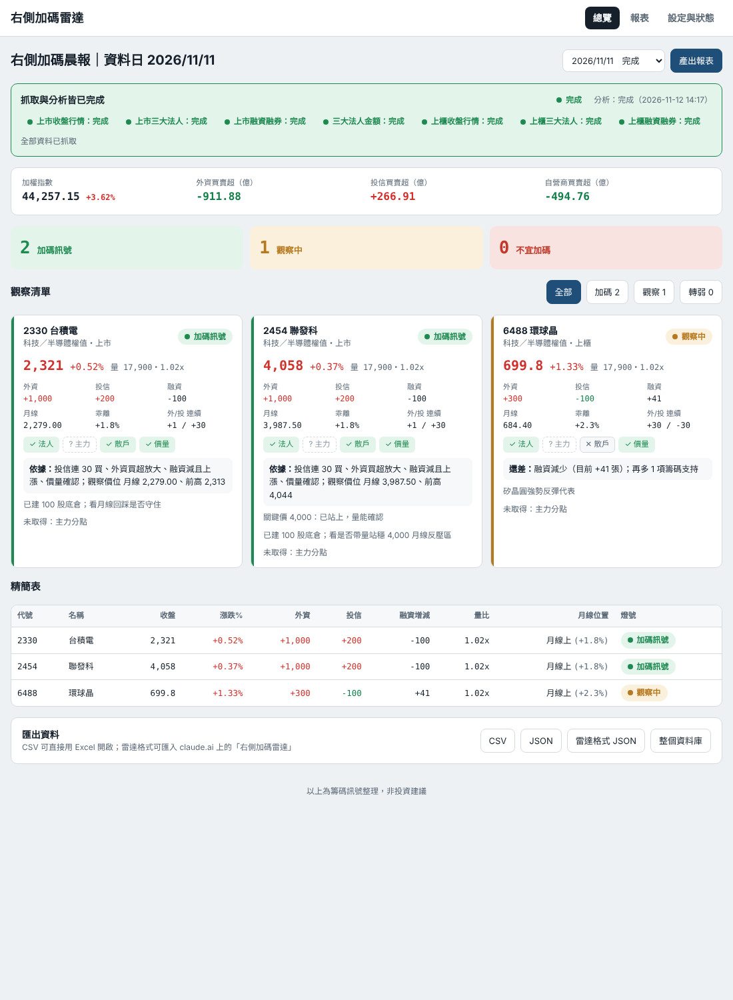
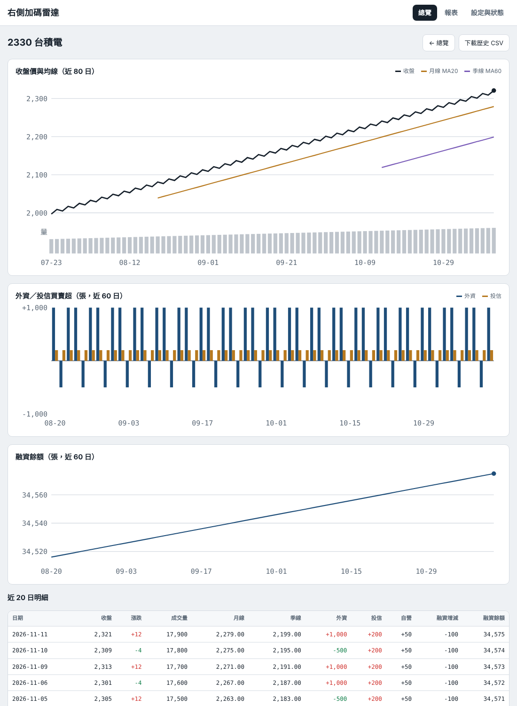
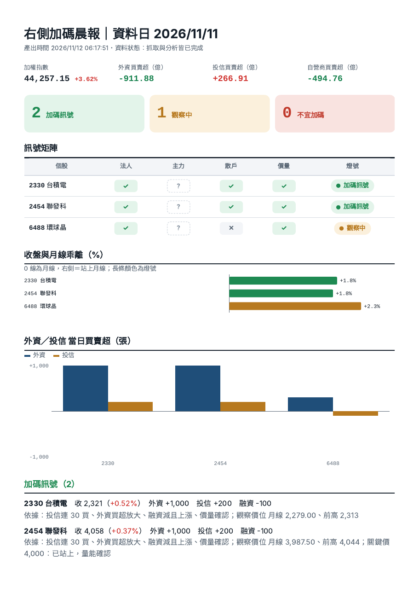

# 右側加碼雷達（twradar）

  

台股盤後籌碼自動爬取 → SQLite 儲存 → 「右側加碼」訊號分析 → Web API 與網頁 UI（含可列印 PDF 報表）。
只用 Python 標準函式庫，不需要資料庫伺服器；macOS 與 Linux 都能一鍵安裝。

*A self-hosted Taiwan stock "right-side entry" signal tracker: nightly crawler for TWSE/TPEx institutional flows, margin balances and prices, stored in SQLite, analyzed with a rule engine, and served through a token-protected JSON API and web dashboard. Pure Python standard library.*

> ⚠️ 本專案僅整理公開籌碼資料並依規則產生訊號，**不構成任何投資建議**。使用者須自行承擔投資風險。

## 功能

- **盤後自動爬取**：證交所、櫃買中心官方全市場資料（收盤行情、三大法人、融資融券、法人金額），每次請求間隔 8 秒以上；官方來源失敗時改用 FinMind 逐檔備援。
- **SQLite 儲存**：全市場每日資料都存下來，新增觀察個股時月線、季線立刻算得出來。
- **右側加碼判定**：法人、主力、散戶、價量四項檢查，產生 🟢 加碼訊號／🟡 觀察中／🔴 不宜加碼，並列出「還差什麼」。門檻可調。
- **有狀態的 Web API**：每個回應都標明抓取與分析是否完成（`status`、`ready`），方便排程或其他程式接手。
- **網頁 UI**：總覽、個股圖表（收盤／月線／季線、法人、融資）、A4 報表（列印成 PDF）、觀察清單與門檻設定、系統狀態。
- **匯出**：JSON、CSV（Excel 可直接開啟）、整個 SQLite 資料庫。
- **一鍵部署**：Mac 點兩下安裝、Linux 一行指令；自動設定開機執行（launchd／systemd）；也提供 Docker。

| 總覽 | 個股 | 報表 |
|---|---|---|
|  |  |  |

<sub>截圖使用測試用的模擬資料。</sub>

## 快速開始（開發者）

```bash
git clone https://github.com/auxotsgh86/twradar.git
cd twradar
python3 -m twradar serve          # 不需要安裝任何套件；預設 http://localhost:8765
python3 -m twradar info           # 顯示網址與 token
python3 -m twradar doctor         # 測試資料來源是否正常
```

資料預設存在 `~/twradar-data`，可用環境變數 `TWRADAR_HOME` 指定。

---

## 一、給借機器的人：安裝只要 3 步

**Mac**
1. 把收到的 zip 檔（或 GitHub 頁面「Code → Download ZIP」下載的檔案）點兩下解壓縮。
2. 打開解壓縮後的資料夾，在「安裝（Mac 請點兩下）.command」上 **按右鍵 → 打開 → 再按一次「打開」**
   （第一次一定要用右鍵打開，直接點兩下會被 Mac 擋下）。
3. 等視窗出現「✅ 安裝完成！」。瀏覽器會自動打開網頁；桌面會多一個「右側加碼雷達-連線資訊.txt」，把這個檔案傳給 Paul 就完成了。

**Linux**
```bash
git clone https://github.com/auxotsgh86/twradar.git && cd twradar && bash deploy/install.sh
```

**之後請保持：** 電腦開機、接上電源、不要進入睡眠（Mac：系統設定 → 電池／能源 → 開啟「防止自動進入睡眠」）。
程式會在開機後自動執行，不需要任何操作。

---

## 二、給維護者（Paul）

### 安裝後的位置
| 項目 | 位置 |
|---|---|
| 程式 | `~/twradar-app` |
| 資料庫、設定、紀錄 | `~/twradar-data`（`twradar.sqlite3`、`config.json`、`twradar.log`） |
| 服務 | Mac：`~/Library/LaunchAgents/tw.radar.plist`；Linux：`systemctl --user status twradar` |

更新版本：解壓新版後重跑安裝即可，資料與 token 保留。移除：`bash deploy/uninstall.sh`（加 `--purge` 連資料一起刪）。

### 第一次啟動會發生什麼
1. 建立預設觀察清單（13 檔，可在網頁「設定與狀態」修改，上限 50 檔）。
2. 背景補抓約 100 個交易日的全市場資料（每次請求間隔約 8～10 秒，約 1～2 小時），進度顯示在「設定與狀態」。
3. 之後每個交易日自動排程（台北時間，可在 `config.json` 的 `schedule` 修改）：

| 時間 | 動作 |
|---|---|
| 17:40 | 抓當天收盤行情、三大法人 |
| 21:50 | 補抓融資融券等較晚公布的資料 |
| 23:40 | 再補一次 |
| 隔天 06:40 | 前一交易日最後一次補抓；仍缺的資料標為「部分缺漏」 |

每次抓完會自動重新分析。

### 確認資料來源是否正常
```bash
cd ~/twradar-app && TWRADAR_HOME=~/twradar-data .venv/bin/python -m twradar doctor
```
會逐一測試證交所、櫃買中心、FinMind 是否可連線、格式是否能解析。**部署後請先跑一次。**
可加 `--date 2026-11-11` 指定測試日。若櫃買中心有項目失敗，再執行 `probe`（同樣可加 `--date`），
它會列出每個候選網址實際回傳的日期、欄位與第一列資料，把輸出交給維護者即可修正。

### 讓 Claude 晨報從外部讀取 API
機器通常在家用網路後面，需要一個固定的 HTTPS 網址。擇一：

- **Tailscale Funnel（推薦，免費、網址固定）**：在該機器安裝 Tailscale 並登入，執行
  `tailscale funnel --bg 8765`，會得到 `https://<機器名>.<tailnet>.ts.net`。
- **Cloudflare Tunnel**：有自己的網域時使用 named tunnel，指向 `http://localhost:8765`。

拿到網址後，把「網址 + token」交給 Claude，晨報排程就會改成從 API 讀資料。
API 全部需要 token，請不要公開分享含 token 的網址。

---

## 三、API

認證：`Authorization: Bearer <token>`、`X-Token: <token>`，或網址加 `?token=<token>`（方便只能發 GET 的工具）。

| 方法 | 路徑 | 說明 |
|---|---|---|
| GET | `/api/v1/health` | 服務是否在線（不需 token） |
| GET | `/api/v1/latest` | 最新交易日的完整結果 |
| GET | `/api/v1/latest?ready=1` | 最新「抓取＋分析都完成」的交易日 |
| GET | `/api/v1/days/{YYYY-MM-DD}` | 指定日；`?format=csv`、`radar`（可匯入 claude.ai 雷達工具）、`status`（只回狀態） |
| GET | `/api/v1/stocks/{code}/history?days=120` | 個股歷史（含 MA20/MA60、法人、融資）；`&format=csv` |
| GET | `/api/v1/dates` | 所有日期與狀態 |
| GET | `/api/v1/status` | 系統狀態、排程、補抓進度 |
| GET/POST/DELETE | `/api/v1/watchlist` | 觀察清單（POST JSON：`code,name,market,group,note,keyLevel`） |
| GET/PUT | `/api/v1/rules` | 判定門檻 |
| POST | `/api/v1/crawl` `/api/v1/analyze` `/api/v1/backfill` | 手動觸發 |
| GET | `/api/v1/export/sqlite` | 下載整個資料庫 |

### 回應一定帶狀態
```json
{
  "date": "2026-11-11",
  "status": "complete",
  "ready": true,
  "statusText": "抓取與分析皆已完成",
  "crawl":    { "status": "complete", "attempts": 2, "finishedAt": "...", "steps": { "twse_margin": {"status": "ok"} } },
  "analysis": { "status": "complete", "analyzedAt": "..." },
  "market": { "taiex": 44257.15, "taiexChgPct": 3.62, "foreignAmt": -7.66, "unit": "億元" },
  "summary": { "go": 0, "wait": 5, "stop": 7, "na": 1 },
  "stocks": [ { "code": "2330", "data": { "close": 2395, "ma20": 2362.75 }, "signal": { "light": "wait", "needs": ["..."] } } ]
}
```

| `status` | 意思 |
|---|---|
| `not_started` | 這天還沒開始抓 |
| `running` | 抓取中 |
| `waiting` | 部分資料交易所尚未公布，會在下個排程自動重抓 |
| `complete` | 全部資料已抓到 |
| `partial` | 最後一次嘗試後仍有缺漏（缺什麼寫在 `crawl.message`、`crawl.steps`） |
| `failed` | 全部失敗（網路或被封鎖） |
| `holiday` | 休市 |

`analysis.status`：`not_started` → `provisional`（依不完整資料先算的暫定結果）→ `complete`。
**`ready: true` 只在 `status=complete` 且 `analysis.status=complete` 時成立**，自動化程式請以它為準。

### 欄位（張為單位，除非另註）
`close` 收盤、`chgPct` 漲跌幅%、`vol` 成交量、`vol5` 前 5 日均量、`ma20`/`ma60` 月線/季線、`prevHigh` 前 20 日最高收盤、
`foreign`/`trust`/`dealer` 外資/投信/自營商買賣超、`foreignStreak`/`trustStreak` 連續買(+)/賣(−)天數、
`foreign5d`/`trust5d` 近 5 日累計、`marginChg`/`shortChg` 融資/融券增減。

---

## 四、判定規則
與 claude.ai 上的「右側加碼雷達」相同：法人、主力、散戶、價量四項；
🟢 價量確認＋至少兩項籌碼支持且無扣分；🔴 跌破月線（含容許誤差）、籌碼背離或爆量長黑；其餘 🟡。門檻可在網頁調整。

## 五、已知限制
- 證交所四項、櫃買中心三項來源皆已在實機確認可依日期抓取（2026/11）。程式會分辨「網站回傳較新日期（參數不對）」與「當日尚未公布」兩種情況，前者立即改用 FinMind 備援。
- 主力分點、買賣家數差沒有官方全市場資料，目前不抓，判定時該項顯示「?」。
- 休市判斷：平日 17:00 後證交所仍無當日資料就視為休市。
- FinMind 免費額度有限；量大時可到 finmindtrade.com 申請 token，填入 `config.json` 的 `finmind_token`。

## 專案結構

```
twradar/
  sources.py    資料來源解析（證交所、櫃買中心、FinMind）
  net.py        HTTP 抓取：請求間隔、重試、封鎖偵測
  jobs.py       抓取流程、歷史補抓、背景工作佇列、每日排程
  analysis.py   指標計算（MA20/MA60、均量、連續買賣）與訊號判定
  server.py     Web API 與靜態網頁
  db.py         SQLite 結構與存取
  web/          網頁 UI（原生 JS、SVG 圖表，無外部相依）
deploy/         一鍵安裝／移除腳本（macOS launchd、Linux systemd）
tests/          單元與端到端測試（內含模擬交易所伺服器）
```

## 開發與測試

```bash
python3 -m unittest discover -s tests -v   # 解析、判定、端到端（模擬交易所 → 抓取 → 分析 → API）
TWRADAR_HOME=./dev-data python3 -m twradar serve
docker compose up -d                        # 或用 Docker
```

歡迎發 Issue 或 Pull Request，尤其是櫃買中心格式的實測修正。

## 資料來源與使用規範

資料取自臺灣證券交易所、證券櫃檯買賣中心公開資訊，以及 FinMind（選用）。請遵守各網站的使用條款，
保持低請求頻率，勿將本程式用於大量或高頻抓取。

## 授權

[MIT](LICENSE) © 2026 Paul
